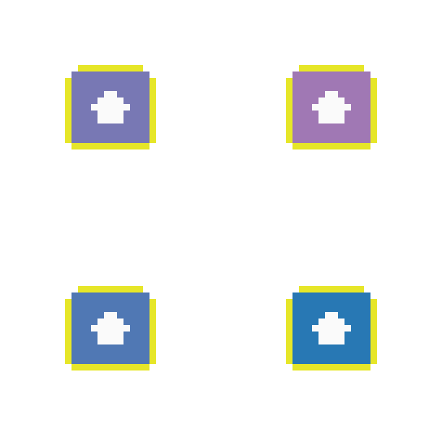

# Station Fence

Barebones of a cyberpunk pawnshop sim for Steam — the skeleton a *Probably Stolen*-style
game needs: deterministic day loop, hidden-value items, appraisal, haggling, contraband
risk, rent pressure, save/load. Godot 4.7, no plugins, no asset dependencies.



## Run it

```bash
# Godot 4.7+ (standard or .NET build both work; this project uses GDScript)
godot --path .                    # play
./check.sh                        # unit tests + headless UI smoke
```

Controls: buttons only. `Next customer` → `Appraise` → `Buy at ask` / `Lowball` →
pick a shelf item → `Sell selected` → `End day`. Rent is charged at closing.

## What is already implemented

| System | File | Notes |
|---|---|---|
| Item data + load | `scripts/core/item_db.gd`, `data/items.json` | 10 items, JSON so adding content needs no engine |
| Item instance | `scripts/core/item_instance.gd` | condition, hidden modifiers, `hot` flag, `true_value` |
| Appraisal | `item_instance.gd::estimate()` | exactness scales with `inspection_skill` vs `inspect_difficulty` |
| Customers | `scripts/core/customer.gd` + `day_cycle.gd` | 4 archetypes, archetype-dependent ask ratio and retail ceiling |
| Negotiation | `scripts/core/deal.gd` | pure static functions, no scene deps |
| Consequences | `deal.gd` | heat, reputation, undercover seizure |
| Day / rent | `day_cycle.gd` | 16 visitors/day, rent `70 + 12·day` |
| Run state | `scripts/autoload/game_state.gd` | cash, heat (decays 8/day), rep, inventory, game over |
| Save/load | `scripts/core/save_game.gd` | JSON in `user://`, versioned |
| UI | `scripts/ui/shop_screen.gd`, `scenes/main.tscn` | built in code; scene file is 8 lines |
| Art pipeline | `tools/asset_pipeline.py` | key-out → 32px grid → palette-lock → atlas + JSON |

## Design invariants (enforced by tests)

1. Same seed ⇒ same customer stream (replays, bug reports, balance runs).
2. Sellers ask **under** market value — that gap is the player's margin. Retail ceiling sits above it.
3. Illegal goods raise heat; heat raises bust chance; heat decays daily.
4. An undercover customer never seizes legal goods, always seizes contraband.
5. A competent strategy (buy ≤92% of appraised low, hold until ≥115% over cost, keep rent in reserve) turns a profit over 10 days. Current run: spent 2384 → earned 4060, cash 500 → 816.

## Tests

```bash
./check.sh          # 183 assertions + headless UI smoke
```

- `tests/run_tests.gd` — core sim: determinism, appraisal bands, negotiation, heat,
  seizure, rent, save/load round-trip, 10-day economy simulation.
- `scripts/ui/shop_screen.gd::_smoke()` — boots the real scene headless, drives the
  actual buttons, asserts the HUD advanced and cash changed.

Both are engine-level, so they catch GDScript parse errors too (the runner verifies
every script compiles before asserting anything).

## Art pipeline

```bash
python3 tools/asset_pipeline.py --src assets/raw --out assets/generated --grid 32 --colors 32 --scale 8
# optional: --palette palette.hex   (one #rrggbb per line, locks a whole cast to one ramp)
```

Takes raw AI output (1024², flat magenta backdrop), floods the key colour out from the
borders, downscales to the real pixel grid, quantizes to one palette, then packs a
1× atlas + `atlas.json` + a scaled preview. Run it on a batch of 200 icons and you get a
consistent set; judge the preview, not the source render.

## Not there yet

No audio, no sprite rendering of the shop (the UI is text), no factions, no multi-business,
no localization, no Steam integration, no balance beyond day 10, no tutorial, no
settings/pause, no controller support, no achievements.

See `docs/roadmap.md` for the milestone order and `docs/steam-checklist.md` for the
store/release side. The AI disclosure point in the checklist matters: Steam requires
declaring generative-AI assets, and it has to be decided before the page goes live.

## Layout
```
project.godot           # Godot 4.7, nearest-neighbour filtering for pixel art
scenes/main.tscn        # one Control node + script
scripts/core/           # pure sim: no scene, no singleton, unit-testable
scripts/autoload/       # GameState: the only mutable run state
scripts/ui/             # shop counter + headless smoke test
data/items.json         # content
tests/                  # headless test runner (extends SceneTree)
tools/                  # art pipeline
docs/                   # roadmap, Steam checklist
check.sh                # tests + smoke, exits non-zero on failure
```

## License

Code: MIT (add a LICENSE before publishing). Assets you generate: yours, subject to the
generator's terms.
